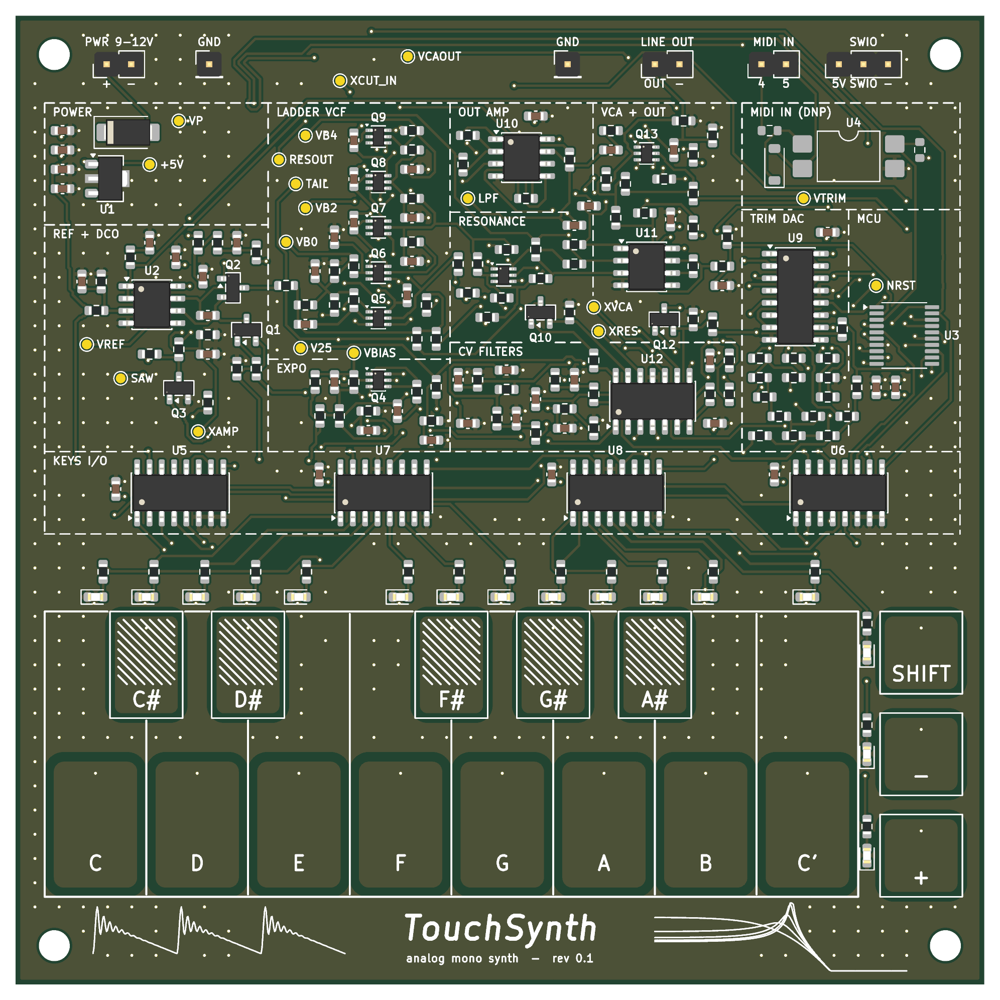

# TouchSynth

A small MCU-controlled analog monophonic synthesizer on a 100 × 100 mm, 4-layer PCB. It has no
potentiometers and no mechanical switches: 13 capacitive touch keys plus SHIFT / − / + play and edit it, and
16 LEDs show the settings. A CH32V003 (or CH32V002 / V006) generates the oscillator timing and four
PWM control voltages for a discrete analog voice:

- **DCO:** a TL072 integrator reset by the MCU timer. The charge current tracks pitch, so the saw amplitude
  stays flat. Saw, variable-width pulse, sub-oscillator and noise.
- **VCF:** a 24 dB/oct transistor ladder (BC847BS) with an expo converter and resonance up to self-oscillation.
- **VCA:** a differential-pair VCA. An 8-bit R-2R trim DAC nulls the CV feedthrough ("thump").
- **Line out,** an audio loopback into the MCU ADC (for calibration and tests), and an optional MIDI in.

All assembled parts are JLCPCB **Basic** or **Promotional Extended** parts: 40 BOM lines, 196 placements,
about USD 3.65 of parts per board at list price. The MCU, headers and MIDI parts are hand-soldered.



**Status (2026-10-18):** board 1 (rev 0.1, CH32V006) is built and brought up. It passes the bring-up steps
and functional tests T1, T2 and T4–T12 (noise marginal at about −55 dB); T3 (touch scan rate) and T14 (MIDI)
have not been measured. The results are in the
[design report](docs/report/touchsynth_report.pdf), section 10. Firmware 0.1 runs on the board, including
multitrack demo pieces and percussion presets. Calibration storage in flash is still open.

The `polyphonic_exp` branch experiments with extensions. So far it turns the pulse output into a PWM DAC
(CH32V006) for digital voices through the analog filter and VCA, starting with a modal timpani, the *kettle*
([kettle_model.mp3](docs/audio/pieces/kettle_model.mp3); report, section 10.5).

Design: cpldcpu & Claude Opus 5.5.

## Hear it

Recorded from board 1's line out. The synth is monophonic, so the multitrack pieces were played one part at a
time and mixed:

| Piece | Board 1 | Model |
|---|---|---|
| *TouchSynth Demo*, original, 7 parts (drums, acid bass, arp, lead, pad) | [demo_hw](docs/audio/demo/touchsynth_demo_hw.mp3) | [demo_model](docs/audio/demo/touchsynth_demo_model.mp3) |
| Purcell, *Queen Mary's March*: 4 trumpets, bass, timpani (modal synthesis on the PWM DAC) | [march_hw](docs/audio/pieces/march_hw.mp3) | [march_model](docs/audio/pieces/march_model.mp3) |
| Bach, Toccata BWV 565, mm. 1–30: 9 organ voices | [toccata_hw](docs/audio/pieces/toccata_hw.mp3) | [toccata_model](docs/audio/pieces/toccata_model.mp3) |
| *Aerosphere*, original space-synth piece, 8 parts | [aero_hw](docs/audio/pieces/aero_hw.mp3) | [aero_model](docs/audio/pieces/aero_model.mp3) |
| Suite: Aerosphere intro into the Toccata | [suite_hw](docs/audio/pieces/suite_hw.mp3) | [suite_model](docs/audio/pieces/suite_model.mp3) |

The three built-in demo tunes (SHIFT + C' on the board), recorded from board 1:
[acid](docs/audio/hw_board1/tune_acid.mp3), [prelude](docs/audio/hw_board1/tune_prelude.mp3) (Bach BWV 846) and
[ode](docs/audio/hw_board1/tune_ode.mp3) (Beethoven). Also from the board: a
[waveform tour](docs/audio/hw_board1/waveforms.mp3) and a [scale on the self-oscillating filter](docs/audio/hw_board1/selfosc_scale.mp3).
The behavioural model renders every single feature (waveforms, filter, envelopes, glide, …) in
[docs/audio/features/](docs/audio/features/). [docs/README.md](docs/README.md) lists all audio files.

## Documents

| Document | Content |
|---|---|
| [docs/report/touchsynth_report.pdf](docs/report/touchsynth_report.pdf) | **design report**: requirements, architecture, circuits, simulations, PCB, BOM, firmware, demo tunes and instruments, V&V with the board 1 results |
| [docs/README.md](docs/README.md) | index of everything in `docs/`: documents, figures, result data, audio |
| [docs/spec.md](docs/spec.md) | specification and design decisions (some pre-layout details are outdated; the report is current) |
| [docs/sim_report.md](docs/sim_report.md) | simulation report S1–S7 and the behavioural model |
| [docs/verification_plan.md](docs/verification_plan.md) | bring-up, functional tests, calibration and validation, board 1 results |
| [docs/touchsynth_schematic.pdf](docs/touchsynth_schematic.pdf) | schematic (7 sheets) |
| [firmware/touchsynth/README.md](firmware/touchsynth/README.md) | firmware build, playing instructions and test console |
| [hw/README.md](hw/README.md) | schematic generator scripts |

## Repository layout

```
docs/        report (LaTeX), spec, simulation report, V&V plan, figures, audio examples, result CSVs
sim/         ngspice simulations S1–S7 (one folder per block), shared netlists and models, behavioural model
hw/          design.py (single source of truth) -> KiCad schematic, PCB, routing and fab outputs
  touchsynth/  KiCad 10 project (generated; edit the Python sources, not the KiCad files)
firmware/    touchsynth/ firmware 0.1, ch32fun (git submodule)
parts/       JLCPCB Basic / Promotional Extended part lists
tools/       bench tools: hardware tests, scope recording, multitrack mixing, figures; Freerouting jar (not in git)
```

## Flow

Every stage is generated by scripts from [hw/design.py](hw/design.py), which holds the parts, values, LCSC
numbers and nets.

```
simulate      sim/s*/s*.py                 ngspice-42 in WSL -> docs/results/*.csv, docs/figures/*.png
model         sim/behav/validate.py        behavioural model vs. ngspice
              sim/behav/examples.py        audio examples + spectrograms
schematic     hw/gen_sch2.py               -> hw/touchsynth/*.kicad_sch
              hw/check_netlist.py          KiCad netlist == design.py
              hw/check_sim.py              design.py == simulation netlists
PCB           hw/gen_pcb.py [--route]      placement, silkscreen art, planes, Freerouting + GND stitching
              hw/gen_pcb.py --finish       post-route clean-up (islands, leftovers via the A* router)
fab           hw/fab.py                    gerbers, drill, BOM and CPL -> hw/touchsynth/production/
report        docs/report/gen_tables.py    then: latexmk -pdf touchsynth_report.tex (WSL)
firmware      firmware/touchsynth/gen_tables.py, check_pins.py, make
tunes         sim/behav/tunes.py, pieces.py    demo tunes, multitrack pieces and presets (-> firmware tables)
bench         tools/hwtest.py              functional tests over the SWIO console -> docs/results/hw_board1*
              tools/hw_figures.py          board 1 figures for the report
              tools/record_parts.sh        record one multitrack part per take with the scope (on the lab PC)
              tools/mix_parts.py, suite.py align, clock-correct and mix the takes -> docs/audio/
```

The bench tools need the lab setup (the PC with the programmer, the scope address) in `tools/lab.conf`: copy
[tools/lab.conf.example](tools/lab.conf.example) and edit it; `lab.conf` is not in git.

`gen_pcb.py` needs KiCad's bundled Python (`pcbnew`) and Java 17 for Freerouting 1.9.0. The hw scripts find KiCad 10
in its standard install folder, or in `KICAD_DIR` if set. The other Python
scripts use a normal Python 3 with numpy and matplotlib. ngspice, LaTeX and the RISC-V toolchain run in WSL.

## Key numbers

| | |
|---|---|
| Supply | 9–12 V DC, about 31 mA (simulated); board 1: 25 mA, MCU running, LEDs off |
| Pitch range | C1 … C8, saw amplitude flat within ±2.2 % |
| Filter | 20 Hz … 20 kHz cutoff, −23 dB/oct, self-oscillation |
| VCA | 121 dB off-attenuation, thump < 0.6 mV after trim |
| Output | about 1.2 Vpp line level, AC-coupled |
| Control | 4 × 12-bit CV (10-bit PWM at 46.9 kHz + 2-bit dither), 1 kHz envelope / LFO rate |
| Touch | 16 pads via 2 × CD4051, 1.4 kHz scan |
| PCB | 100 × 100 mm, 4 layers (signal / GND / split power / signal), 242 parts, 166 nets |
