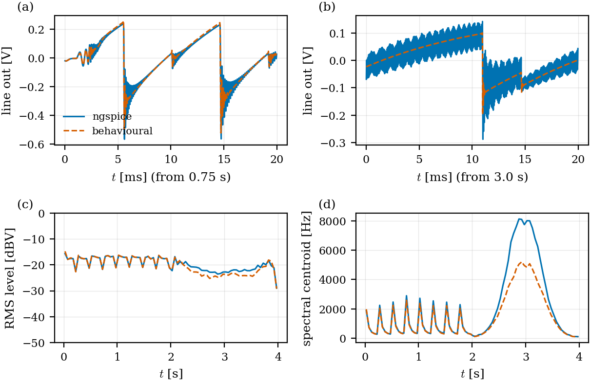

# TouchSynth — Circuit Simulation Report

Revision 2 · 2026-09-26 · ngspice-42 (WSL) · scripts in [`sim/`](../sim/) · spec [spec.md](spec.md) · V&V plan [verification_plan.md](verification_plan.md)

Revision 2 corrects the CV filter networks (the last RC stage loaded the earlier ones; found while validating
the behavioural model, §9), lowers the VCA maximum gain, and adds the behavioural model (§11).

## Summary

All seven simulation blocks meet their specification after the design changes listed in §10. The
complete voice renders to audio in [`audio/s6_voice.wav`](audio/s6_voice.wav); per-feature audio examples from
the behavioural model are in [`audio/features/`](audio/features/).

| # | Block | Key requirement | Result | Status |
|---|---|---|---|---|
| S1 | DCO | saw amplitude flat ±5 % over C1…C8, 9–12 V | −2.2 % / +0.8 % around mean; supply-independent | pass |
| S2 | CV filters | ripple < −70 dB FS, settling < 2 ms | −81 dB / −84 dB; 1.3 ms / 1.2 ms (1 %) | pass |
| S3 | Ladder VCF | 30 Hz…15 kHz, 24 dB/oct, resonance to self-oscillation | 19.9 Hz…19.8 kHz, −23 dB/oct, self-osc. from CV_RES ≈ 3.1 V | pass |
| S4 | VCA | ≥ 70 dB off, low CV feedthrough | 121 dB off; thump 94–101 mV → < 0.6 mV after trim | pass |
| S5 | Touch | Δ ≥ 5 × noise, scan ≥ 200 Hz | SNR 39 (V003) / 152 (V002) worst case; 1.4 kHz | pass |
| S6 | Full voice | plausible sound, loopback in range | 1.22 Vpp line out; loopback node 2.3…2.9 V | pass |
| S7 | Power | 9–12 V, ≤ 60 mA, low hum | 33 / 42 mA; hum −81 dB re 1.33 Vpp | pass (power-on pop accepted, §8.3) |

Accepted limitations: power-on pop at the line out (§8.3) and cutoff temperature drift (§4.4). See also the
model limitations (§12).

## 1. Method

- **Simulator**: ngspice-42 in batch mode, driven by Python scripts (one folder per block, shared netlist
  snippets in [`sim/lib/voice.py`](../sim/lib/voice.py), models in [`sim/models/models.lib`](../sim/models/models.lib)).
- **Models**: TI Boyle macromodels for TL072 and LM324, NXP Gummel-Poon BC847B (used for both halves of
  BC847BS), generic MMBT3904, LTspice VDMOS 2N7002, behavioural 78L05.
- **Supply corners**: V+ = 8.6 V (9 V input minus SS14 drop) and 11.6 V (12 V input).
- **Control voltages** are applied through the real PWM filter networks everywhere (since revision 2).
- **Firmware in the loop**: S1, S6 compute timer periods, PWM codes and envelopes exactly as the firmware
  will (48 MHz timer quantisation, 12-bit CV codes, 1 kHz control rate).
- **Calibrations** found by one simulation and used by others (DCO gain, cutoff table, VCA law, resonance
  threshold) are written to [`results/`](results/) and read back, never copied by hand.
- **Figures**: vector PDF + PNG in [`figures/`](figures/), numeric results as CSV in [`results/`](results/)
  (ready for the LaTeX design report).

## 2. S1 — Digitally controlled oscillator

**Circuit.** TL072 inverting integrator (C = 10 nF, non-inverting input at VREF = 4.5 V). The charging current
is drawn from the summing node by an LM324 + MMBT3904 V→I converter (fed from the LIN CV network, DC ratio
0.591, R_E = 33 k), so the saw ramps *up* from 4.5 V. TIM2 CH1 issues a 3 µs reset pulse per period; an
MMBT3904 level shifter (4.7 k base, 10 k pull-up to V+, 2.2 k gate resistor) drives a 2N7002 across the
capacitor. For constant amplitude the firmware sets CV_AMP ∝ f: `I = A·C/(T − t_reset)`.


*Figure 1 — (a) saw at 33 Hz, 262 Hz and 2.96 kHz over two periods (time normalised to the period);
(b) reset detail at 4.19 kHz: MCU pin, 2N7002 gate and saw.*


*Figure 2 — (a) saw amplitude vs note at both supply corners; (b) firmware CV_AMP law and 12-bit code.*

**Results.**
- Ramp 4.53 V → 6.50 V; amplitude 1.956 Vpp mean (−2.2 % gain error, removed by one calibration constant).
- Flatness over C1…C8 and both supplies: −2.2 % / +0.8 %. The low end is limited by 12-bit quantisation
  and LM324 offset.
- Reset completes in ≈ 2.5 µs; the gate charge injection leaves a ≈ 0.43 V, ≈ 100 ns spike and a 34 mV
  offset at the start of the ramp — negligible next to the 2 V reset step.
- V+ has no measurable influence (VREF and the V→I converter are referenced to +5 V / GND).

## 3. S2 — PWM → control-voltage filters

**Circuit.** TIM1 PWM (10 bit @ 46.9 kHz + 2-bit sigma-delta dither), then three RC poles:
1 k / 100 n → 4.7 k / 33 n → last stage. *LIN* (CV_AMP, CV_RES, CV_VCA): 4.7 k / 15 k ‖ 22 n into an LM324
input, DC ratio 15/25.4 = 0.591. *EXP* (CV_CUT): 33 k / 1.5 k ‖ 100 n to VBIAS, directly driving the expo
converter base, ratio 0.0373 (10.4 octaves over the 5 V range). Both ratios include the series resistance of
the first two stages (§9).


*Figure 3 — (a) normalised 10 %→90 % step response; (b) steady-state ripple at 50 % duty with dither.*

**Results** (worst-case duty 50 %, dither active):

| Channel | Full scale | Ripple | re FS | Settling 1 % | Settling 0.1 % |
|---|---|---|---|---|---|
| LIN | 2.95 V | 271 µVpp | −81 dB | 1.31 ms | 1.88 ms |
| EXP | 187 mV | 12 µVpp (0.8 cent of cutoff) | −84 dB | 1.22 ms | 1.68 ms |

**Design history.** The first iteration used 12-bit PWM at 11.7 kHz with poles at 720 Hz: −66.7 dB ripple and
2.2 ms settling. Switching to **10-bit PWM at 46.9 kHz plus 2-bit sigma-delta dithering** (TIM1 DMA burst
updates the compare registers) keeps 12-bit resolution and moves the carrier up by 4×.

## 4. S3 — Transistor ladder VCF

**Circuit.** Classic Moog ladder: input pair + three rungs + load pair (5 × BC847BS), 4 × 33 nF. Bias chain
from V+ (2.2 k / 4 × 1 k / 2.4 k, each tap 10 µF): VB0…VB4 = 2.4…6.4 V at V+ = 8.6 V. The tail current comes
from an exponential converter (BC847BS pair, LM324, I_ref = 8.3 µA via 300 k, 1 nF compensation). The output
across the top capacitor is read by a TL072 two-op-amp instrumentation amplifier (G = 11, output referenced
to VREF); JFET inputs avoid loading the ladder, whose source impedance reaches ≈ 50 kΩ at low cutoff.
Resonance: an AC-coupled BJT differential pair (input 1:13 from the filter output, tail from CV_RES via the LIN
network), whose collectors feed a TL072 unity difference amplifier; its output returns through
4.7 µF + 22 k into the second input of the ladder.


*Figure 4 — (a) ladder response (filter output / ladder input) for CV_CUT = 0…5 V, resonance off;
(b) response at CV_CUT = 2.5 V for CV_RES below the self-oscillation threshold.*


*Figure 5 — (a) steady-state self-oscillation for several CV_RES above threshold; (b) 110 Hz saw through
the filter at different cutoff / resonance settings.*

**Results.**

| Quantity | Value |
|---|---|
| −3 dB cutoff range (CV_CUT 0…5 V) | 19.9 Hz … 19.8 kHz (≈ 10 octaves) |
| Tracking | 2.05 oct/V, log-linear |
| Slope (1 octave far above cutoff) | −23.1 dB/oct |
| Passband gain (ladder in → INA out) | 20.4 dB, flat within 1.6 dB over the full range |
| Resonance peak (CV_CUT 2.5 V) | 4.8 / 13.6 / 20.7 / 28.9 dB at CV_RES 1 / 2 / 2.5 / 2.8 V |
| Self-oscillation threshold | CV_RES ≈ 3.1 V; amplitude 0.11…0.29 Vpp (soft-limited by the diff pair) |
| Supply sensitivity | +19 cent between 9 V and 12 V input |
| Temperature drift | −13.4 cent/K (25 → 45 °C) |

### 4.4 Temperature drift
The drift is physical (V_T appears in both the expo converter and the ladder transconductance) and amounts
to ≈ 3 semitones over a 20 K warm-up. For this demonstrator it is accepted, as in classic analog filters. A
dedicated temperature sensor was considered and dropped; if needed, the firmware can re-tune the cutoff
without extra parts by measuring the self-oscillation frequency through the audio loopback (T7).

## 5. S4 — VCA

**Circuit.** BC847BS differential pair, bases biased from VREF (1 k each), input from the filter AC-coupled
and attenuated 1:34. Tail from an LM324 V→I converter (LIN network, R_E = 4.7 k) with a **470 k pull-up from
+5 V on the emitter** so the current is truly zero at CV = 0 despite op-amp offset. Collectors 4.7 k to V+
into a TL072 difference amplifier (10 k / 22 k) → 10 µF → line out. An 8-bit R-2R DAC on a third 74HC595
injects a trim current (1 M into one base, fixed 2 M from the other base to GND, range ≈ −1.8…+2.7 mV).


*Figure 6 — (a) gain vs CV_VCA (nominal, +7 mV op-amp offset, and without the 470 k anti-offset resistor);
(b) CV feedthrough for a 0→full CV step without signal: two mismatch cases before and after the firmware
trim calibration.*

**Results.**
- Maximum gain +7.4 dB (0.6 Vpp in → 1.39 Vpp out); THD 0.06 % / 0.21 % / 0.81 % at 0.3 / 0.6 / 1.2 Vpp input.
- Off attenuation 121 dB. Without the 470 k anti-offset resistor a +7 mV LM324 offset leaves only 52 dB.
- CV feedthrough with realistic mismatch (±1 % collector resistor, 1–2 mV V_BE offset): 94–101 mV steps,
  i.e. an audible thump at every note. Both error terms scale with the tail current, so a single static
  offset trim cancels both: after the two-point calibration the residual is 0.58 mV and 0.08 mV
  (trim codes 34 and 230).

## 6. S5 — Capacitive touch through CD4051

**Model.** ch32fun `ch32v00x_touch.h` slope method (`TOUCH_SLOPE = 1`): pin driven high, released to the
internal pull-down (35/45/55 kΩ), ADC sample-and-hold (1 kΩ, 3 pF V003 / 4 pF V002) samples the first
0.625 µs of the decay. Path: MCU pin 5 pF, CD4051 common 30 pF, R_ON 470 Ω, channel 5 pF, trace 3 pF,
pad 6 pF, finger 0…20 pF.


*Figure 7 — (a) pin voltage after release for 0, 5 and 20 pF finger capacitance; (b) ADC code increase per
sample vs finger capacitance, through the multiplexer and direct (R_PD = 45 kΩ).*

**Results.** The multiplexer's 30 pF common capacitance costs ≈ 5× sensitivity versus a direct pin, but the
margin stays large: for a 5 pF touch, 14.8…20.8 LSB/sample (V003) and 57…81 LSB/sample (V002). With 16
samples per pad and an assumed 1.5 LSB rms ADC noise, the worst-case SNR is 39 (V003) / 152 (V002). A full
16-pad scan takes ≈ 0.69 ms (1.4 kHz).

## 7. S6 — Full voice

**Setup.** The complete analog circuit (DCO, mixer, ladder with resonance, VCA, loopback divider) with the
firmware modelled in Python: TIM2 periods quantised at 48 MHz, sub-oscillator toggled per period, pulse
width modulated by a firmware LFO, ADSR envelopes, all CVs mapped through the calibrations from S1, S3 and
S4 and updated at 1 kHz. Score: an eight-note bass line with filter envelope and sub-oscillator (0–2 s),
then a held A1 with pulse-width modulation and a slow resonant filter sweep (2–4 s).


*Figure 8 — (a) line out; (b) spectrogram; (c) detail at 0.75 s: DCO saw (offset), filter output and line out.*

**Results.** Line out 1.22 Vpp peak. The loopback ADC node (10 k / 15 k divider) stays within 2.34…2.88 V,
well inside 0…5 V. Listen: [`audio/s6_voice.wav`](audio/s6_voice.wav). In part 2 the resonance setting lies
right at the self-oscillation threshold, so the filter rings at high cutoff. The pulse-width LFO shifts the
DC content of the pulse wave, which appears as a slow (0.7 Hz) wobble of the line-out baseline — inaudible.

## 8. S7 — Power and references

**Circuit.** SS14 reverse protection, 10 µF + 100 nF, 78L05 (+5 V for logic and references). VREF = 4.5 V from a
1 k / 9.1 k divider (10 µF) buffered by a TL072 follower with a **10 Ω + 1 µF output snubber**. VBIAS
(1.5 V) and V25 (2.5 V) are dividers from +5 V. MCU-generated CVs are modelled ratiometric to +5 V.


*Figure 9 — (a) power-up at 9 V; (b) VREF response to a 1 mA load step.*

**Results.**

| Vin (+200 mVpp 100 Hz ripple) | +5 V ripple | VREF ripple | Line-out ripple | Hum re 1.33 Vpp | Input current |
|---|---|---|---|---|---|
| 9 V | 0.12 mVpp | 19 µVpp | 112 µVpp | −81 dB | 32.7 mA |
| 12 V | 0.12 mVpp | 19 µVpp | 113 µVpp | −81 dB | 42.2 mA |

(Input current includes an assumed 15 mA for MCU, logic and LEDs.)

**Design history (VREF buffer).** A TL072 driving 10 µF through a 100 Ω isolation resistor outside the loop
gave 1.1 mVpp of 100 Hz on VREF (the difference amplifiers draw V+-dependent currents from VREF) and −47 dB
hum. A dual-loop variant fixed the hum but had a 48 Ω output-impedance peak at 2.3 kHz. The final plain
follower with an RC snubber has 0.005 Ω at 100 Hz and a single well-damped 9.6 Ω peak at 2.4 MHz; a bare
100 nF on the output (313 Ω peak at 190 kHz) is explicitly avoided.

### 8.3 Power-on pop (accepted)
At power-up the line-out coupling capacitor charges from 0 to the 4.5 V output bias, giving a ≈ 3 V pop that
decays over ≈ 0.3 s (Figure 9a). **Decision:** accepted for the demonstrator — switch the synth on before the
amplifier. The firmware keeps the VCA closed for 0.5 s after boot while the internal coupling capacitors settle.

## 9. Revision 2: CV network loading

The behavioural model (§11) could not match the ngspice full voice until the cause was found in the circuit:
the last RC stage of each CV filter was designed as a divider for an ideal source, but it sits behind the
series resistance of the first two stages. With the revision-1 values the LIN ratio was 0.36 instead of 0.6
(DCO amplitude, resonance and VCA all short of their range) and the EXP span shrank to 67 %, limiting the
real cutoff range to ≈ 44 Hz … 4 kHz. S1 and S3 had fed ideal voltages directly into the dividers, so they
did not see it. The networks were redesigned with the loading included (1 k / 4.7 k first stages, ratios
0.591 and 0.0373), and every simulation now drives the CVs through the real networks. With the corrected
LIN ratio the VCA reached +11 dB and drove the output to ±2.4 V on an open-filter bass saw, so its R_E went
from 3 k to 4.7 k (+7.4 dB) and the loopback divider from 10 k / 30 k to 10 k / 15 k.

## 10. Design changes made during simulation

| Block | Change | Reason |
|---|---|---|
| DCO | 2.2 k gate resistor | slows the switch-off edge, reduces charge-injection spike |
| CV filters | 10-bit PWM @ 46.9 kHz + 2-bit Σ-Δ dither | ripple −67 → −81 dB, settling 2.2 → 1.3 ms |
| CV filters | load-aware networks (1 k/100 n → 4.7 k/33 n → 4.7 k/15 k‖22 n; EXP 33 k/1.5 k‖100 n) | correct DC ratios (§9) |
| VCF | ladder caps 47 → 33 nF | top of range above 15 kHz |
| VCF | mixer: 10 k to VB0, 1 µF coupling, 150 k / 470 k sources | settling 0.44 s → ≈ 15 ms |
| VCF | resonance VCA with difference amplifier, 1:13 input, 22 k feedback | removes volt-level DC steps into the ladder |
| VCA | 470 k anti-offset on the V→I emitter | off attenuation 52 → 121 dB |
| VCA | bases biased from VREF, 8-bit R-2R trim DAC (3rd 74HC595) | CV feedthrough ≈ 100 → < 0.6 mV after calibration |
| VCA | V→I R_E 3 k → 4.7 k | max gain +11 → +7.4 dB, output headroom |
| System | audio loopback (10 k / 15 k + 1 nF) to PD5 | self-test and calibration without extra ICs |
| Power | VREF follower + 10 Ω / 1 µF snubber | hum −47 → −81 dB, stable |

## 11. Behavioural model and audio examples

A fast Python/numba model of the voice ([`sim/behav/behav.py`](../sim/behav/behav.py)) renders audio in seconds
instead of minutes. It mirrors the hardware split: a *firmware layer* (patch parameters, ADSR envelopes, LFO,
glide, per-note accent/slide, timer quantisation, 12-bit CVs at 1 kHz) and an *analog layer* at 192 kHz
(band-limited edge rendering of saw/pulse/sub/noise with polyBLEP, the S2 CV filters, mixer coupling, a Moog
ladder with tanh stages, the VCA diff-pair law, output coupling). Its constants come from the ngspice results:
DCO gain (S1), cutoff table (S3), VCA law (S4), and the resonance loop gain k(CV_RES), obtained by inverting the
S3 resonance peak heights with the ideal 4-pole response and anchoring k = 4 at the S3 threshold. Two
parameters are fitted in [`sim/behav/validate.py`](../sim/behav/validate.py): the pole-to-(−3 dB) ratio from
the self-oscillation pitch (0.471) and the loop-gain slope above threshold from the self-oscillation amplitude.


*Figure 10 — the S6 score rendered by ngspice and by the behavioural model: (a, b) waveform details,
(c) RMS level, (d) spectral centroid.*

| Check | Result |
|---|---|
| Level vs ngspice (S6 score) | −0.6 dB mean, 1.1 dB rms |
| Self-oscillation pitch / amplitude (CV_RES 3.4…5 V) | < 2 % / < 7 % |
| Brightness (spectral centroid) | −300 cent mean; the difference is concentrated in S6 part 2, where the resonance sits exactly at the threshold |

**Audio examples.** 19 feature clips (oscillator, filter, envelopes/VCA, modulation) and three demo tunes in the
firmware step format (3 bytes per step; [`sim/behav/tunes.py`](../sim/behav/tunes.py): an original acid line,
Bach's Prelude in C and Beethoven's "Ode to Joy", both public domain) are in
[`audio/features/`](audio/features/) with spectrograms in [`figures/audio/`](figures/audio/).

## 12. Model limitations

- **Op-amp input common-mode range** is not modelled by the Boyle TL072 model. The design keeps all TL072
  inputs ≥ 4 V (checked: DCO 4.5 V, INA 5.9 V, difference amplifiers 5.5…6.5 V, VREF buffer 4.5 V).
- **Matching**: BC847BS halves are modelled identical except where mismatch is inserted explicitly (S4).
  Expo-pair mismatch only shifts the cutoff scale (calibrated); ladder mismatch adds a DC offset at the INA
  output (AC-coupled downstream).
- **Noise** (thermal, shot, 1/f) is not simulated; the ladder and VCA input levels (tens of mV) are typical
  of classic designs.
- **Capacitor tolerances**: X7R 10 nF / 33 nF have ±10 % tolerance and voltage coefficients. The DCO absolute
  amplitude and the cutoff scale absorb this into the firmware calibration constants.
- **PCB parasitics**, touch-pad coupling between neighbouring keys and LED/595 switching noise are not
  modelled; see the verification plan (T2, T12).
- **Behavioural model**: ideal-ladder structure with fitted constants; accurate for level, pitch and overall
  timbre, less so exactly at the resonance threshold.

## 13. Key component values (input to the schematic)

| Block | Values |
|---|---|
| DCO | C_int 10 nF; V→I from LIN network, 1 k base, R_E 33 k; reset 2N7002, gate 2.2 k, pull-up 10 k to V+, NPN base 4.7 k |
| CV filters | 1 k/100 n → 4.7 k/33 n → LIN 4.7 k / 15 k‖22 n, or EXP 33 k / 1.5 k‖100 n to VBIAS |
| Expo | BC847BS, R_ref 300 k from +5 V, LM324 +in at V25, 1 k to emitters, 1 nF comp.; VBIAS 3.3 k/1.5 k + 1 µF; V25 10 k/10 k + 1 µF |
| Ladder | 5 × BC847BS, 4 × 33 nF; bias 2.2 k/1 k/1 k/1 k/1 k/2.4 k + 5 × 10 µF; input bias 2 × 10 k to VB0; INA 100 k/10 k/10 k/100 k |
| Mixer | saw 150 k, pulse/sub/noise 470 k, 10 k to VB0, 1 µF coupling |
| Resonance | 1 µF, 120 k/10 k from VB2; BC847BS; R_C 2 × 4.7 k; diff amp 4 × 10 k (ref VREF); 4.7 µF + 22 k; V→I R_E 6.2 k |
| VCA | 1 µF, 33 k/1 k from VREF; BC847BS; R_C 2 × 4.7 k; V→I R_E 4.7 k + 470 k from +5 V; diff amp 10 k/22 k; 10 µF out; trim 1 M / 2 M, R-2R 100 k/200 k |
| Loopback | 10 k / 15 k + 1 nF → PD5 |
| Power | SS14; 10 µF + 100 nF; 78L05 + 1 µF + 100 nF; VREF 1 k/9.1 k + 10 µF, TL072 follower, 10 Ω + 1 µF snubber |

## 14. Reproducing

```
cd sim/s1_dco && python s1_dco.py        # likewise s2_cv, s3_vcf, s4_vca, s5_touch, s6_voice, s7_power
cd sim/behav && python validate.py && python examples.py
```
Order matters where calibrations flow: S1 → S3 → S4 → S6 → behav. S6 takes ≈ 2 min, S7 ≈ 10 min, the
behavioural examples ≈ 30 s.
